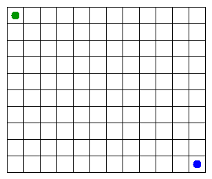

# Assignment 3. Maze Escape

Student ID:
Name:
Group:
Maze size (rows x columns):

This file is the report. Fill it in as you go. How to start: `START_HERE.md`. The task: `docs/Assignment3.pdf`.

## Program output

The 13 lines your program prints on your data (`java -cp out Main`):

    Broken:
    Kept:
    Last broken wall:
    MST cost:
    Heaviest broken wall:
    Path length:
    DFS visited:
    Dead ends:
    Zones:
    Largest zone:
    Is DAG:
    Flow stages:
    Fastest route cost:

My maze:

## Questions

Answer in your own words, two or three sentences each.

Mission 0. What do find and union do, and what makes them fast in your code?

Mission 1. Why is Broken always R*C - 1, and Kept always (R-1)*(C-1)?

Mission 2. My MST cost from Kruskal and from Prim, and why they are equal:

Mission 3. Why is there exactly one path between two cells? How did you avoid a stack overflow on a huge maze?

Mission 4. Why does the second pass of Kosaraju go on the reversed graph? Why do the slides have no cycle exactly when Zones equals the number of cells?

Mission 5. Why is it enough to go through the zones in the order of their numbers? What does this pass cost?

## AI use

The syllabus requires you to say which AI tools you used and for what. Write the tool (ChatGPT, Copilot, other) and what you asked it: explain an idea, find an error, review code. Write "none" if you did not use any. If you took code or text from a book or a website, give the source here.

## Timing (Mission 7)

Milliseconds, 5 runs each, from `java -cp out Bench`.

| maze | Kruskal | Prim |
|---|---|---|
| 100 x 100 | | |
| 300 x 300 | | |
| 1000 x 1000 | | |

What do the numbers say about how the time grows? Two or three sentences.

## Complexity

n is the number of cells, m the number of walls (or slides). Fill in every algorithm you wrote.

| algorithm | time | space | assumptions |
|---|---|---|---|
| DSU find and union | | | |
| Kruskal | | | |
| Prim | | | |
| DFS | | | |
| Kosaraju | | | |
| Route in the zone graph | | | |

## Before you submit

- data/walls.txt, data/slides.txt and output/maze.png are in the repository.
- `java tools/Check.java` shows all examples right.
- This README is filled in, the program output and the section AI use included.
- The work is pushed to main (at least one commit per mission) and the repository is public.
- The link is attached in Moodle.
